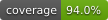
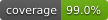

# nwtimetracking

| nwtimetracking | nwtimetrackingcli |
|---|---|
|||

Contact: numbworks@gmail.com

## Introduction

From the documentation:

> `nwtimetracking` is a library that can run several automated data analysis tasks on a time tracking file and save the results as a PDF report. It’s designed to facilitate and gamify a continuous learning journey.

> `nwtimetrackingcli` is a command-line application built on the top of `nwtimetracking`.

## Getting started

- [Documentation (nwtimetracking)](docs/docs-nwtimetracking.md)
- [Documentation (nwtimetrackingcli)](docs/docs-nwtimetrackingcli.md)

## Other links

- [LICENSE](LICENSE)