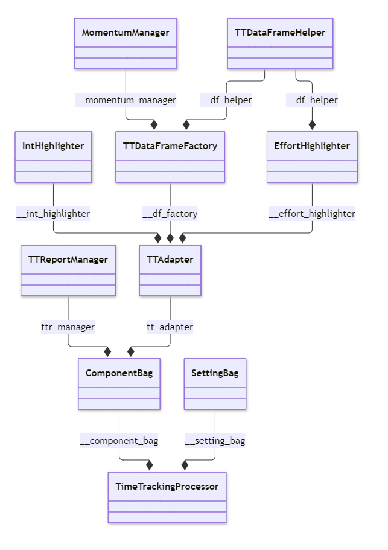

# nwtimetracking
Contact: numbworks@gmail.com

## Revision History

| Date | Author | Description |
|---|---|---|
| 2023-08-21 | numbworks | Created. |
| 2026-10-18 | numbworks | Last update (6.1.0). |

## Introduction

`nwtimetracking` is a library that can run several automated data analysis tasks on a time tracking file and save the results as a PDF report. It’s designed to facilitate and gamify a continuous learning journey.

## Architecture

A partial class diagram showing the core architecture of the application:

## See Also: `asciibannermanager`

This project includes portions of the `asciibannermanager` project, which is documented here:

- [docs-asciibannermanager.md](SeeAlso-asciibannermanager/docs-asciibannermanager.md)

## See Also: `contributionguide`

If you would like to contribute to this project, please take a look at the following document first:

- [docs-contributionguide-python.md](SeeAlso-contributionguide/docs-contributionguide-python.md)

## See Also: `developerguide`

To get started with this project as a developer, please give a look to the following document:

- [docs-developerguide-python.md](SeeAlso-developerguide/docs-developerguide-python.md)

## See Also: `frameworkfreeze`

To learn more about the "framework freeze" strategy adopted by this project, please have a look at the following document:

- [docs-frameworkfreeze-python.md](SeeAlso-frameworkfreeze/docs-frameworkfreeze-python.md)

## See Also: `knownissues`

To learn more about some known issues that might have required a workaround to make this project work, please have a look at the following document:

- [docs-knownissues-python.md](SeeAlso-knownissues/docs-knownissues-python.md)

## See Also: `nwbuilders`

This project includes portions of the `nwbuilders` project, which is documented here:

- [docs-nwbuilders-python.md](SeeAlso-nwbuilders/docs-nwbuilders-python.md)

## See Also: `nwmakefiles`

This project includes portions of the `nwmakefiles` project, which is documented here:

- [docs-nwmakefiles-python.md](SeeAlso-nwmakefiles/docs-nwmakefiles-python.md)

## See Also: `userguide`

To get started with this project as a user, please give a look to the following document:

- [docs-userguide-python.md](SeeAlso-userguide/docs-userguide-python.md)

## Markdown Toolset

Suggested toolset to view and edit this Markdown file:

- [Visual Studio Code](https://code.visualstudio.com/)
- [Markdown Preview Enhanced](https://marketplace.visualstudio.com/items?itemName=shd101wyy.markdown-preview-enhanced)
- [Markdown PDF](https://marketplace.visualstudio.com/items?itemName=yzane.markdown-pdf)